# How this video was made: 1-Video-76236.mp4

**In one line**: Nine fruits of the Spirit explained with compact animated cards, then a PDF offer.
**How it was made**: code / template render 100%

- 0:56 · vertical 9:16 · 13 shots, 4.4s each on average
- Confidence 94%, based on: tool measurements + AI assistant reviewed 13 shots
- ⚠️ 2 points are uncertain, see “Open questions”

<!--mix-->

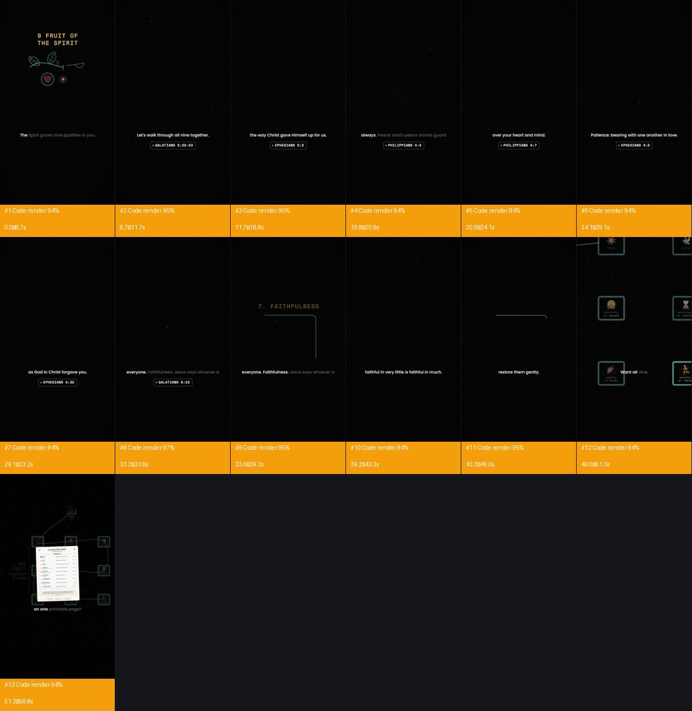

# Part one · Breakdown: how this video is built

## What makes it work

- **The hook**: A cluster of nine symbols introduces a numbered sequence.
- 6.3s: first card slides into focus.
- 22.6s: hourglass rotation reinforces patience.
- 49s: pullback reveals connected card grid.

## At a glance: picture, packaging, sound

Any short video splits into three layers: the picture, what is laid on top of it (subtitles, styled text, stickers), and the sound. Remake it one layer at a time.

| Layer | In this video | How to make it | Detail |
|---|---|---|---|
| **Picture** (base) | code / template render 13 shots | screen recording / motion graphics in code | “Remake it yourself” |
| **Packaging** (on top) | none | — | “Packaging layer” |
| **Sound** | voice（TTS voice-over）, music (89 BPM, to confirm), 6 distinct effects (10 hits) | voice: TTS voice-over; music: find a track with the same tempo and mood; effects: add from a library at the listed times | “Sound” |

## Content and structure

- The narrative line below comes from reading each shot; the lines were not transcribed separately, subtitle text is under “Packaging layer”

**Narrative line**

Keep this line in a remake: same order, same job at each step, with the point refilled from your own cases, numbers and material, so it is more than a change of subject.

| Time | Shots | Job | What it says |
|---|---|---|---|
| 0.0–6.7s | #1 | — | Nine fruits overview |
| 6.7–11.7s | #2 | — | Love: heart |
| 11.7–16.8s | #3 | — | Joy: sun |
| 16.8–20.9s | #4 | — | Peace: dove |
| 20.9–24.1s | #5 | — | Patience: rotating hourglass |
| 24.1–29.1s | #6 | — | Kindness: smiling face |
| 29.1–33.2s | #7 | — | Goodness: hands |
| 33.2–33.6s | #8 | — | Transition gap |
| 33.6–39.2s | #9 | — | Faithfulness: handshake |
| 39.2–43.3s | #10 | — | Gentleness: feather |
| 43.3–49.0s | #11 | — | Self-control: figure |
| 49.0–51.3s | #12 | — | Connected grid pullback |
| 51.3–56.8s | #13 | call to action | PDF download call to action |

## Shot list

| # | Frame | Time | What it says | Picture | Camera |
|---|---|---|---|---|---|
| 1 | 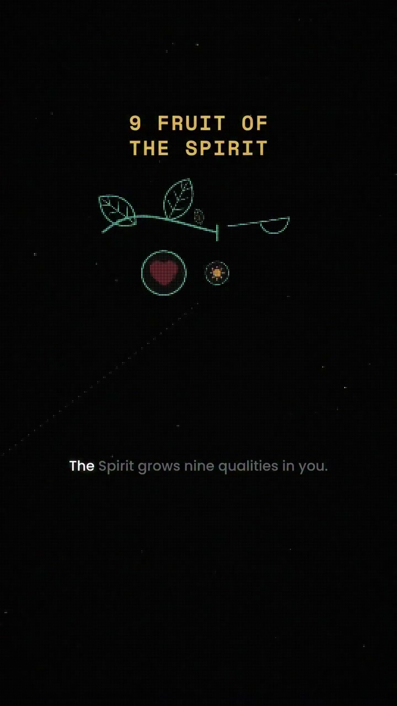 | 0:00.0 · 6.7s | Nine fruits overview | Nine fruits overview on a nearly black textured canvas, mint… | smooth move |
| 2 | 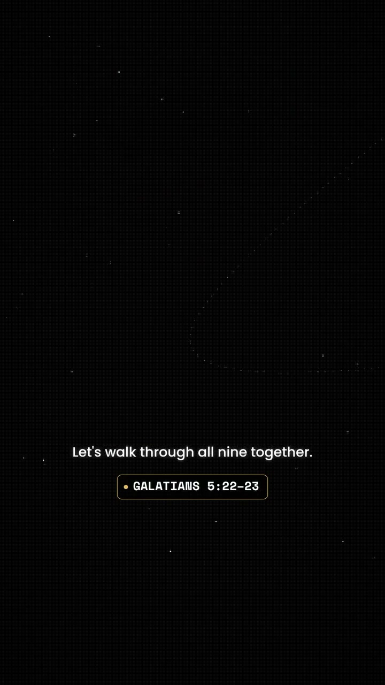 | 0:06.7 · 4.9s | Love: heart | Love: heart on a nearly black textured canvas, mint outline … | static |
| 3 | 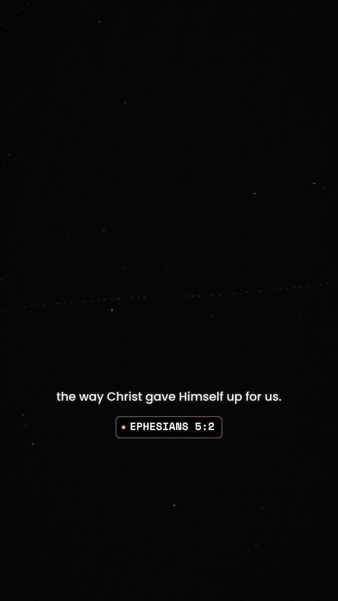 | 0:11.7 · 5.1s | Joy: sun | Joy: sun on a nearly black textured canvas, mint outline car… | static |
| 4 | 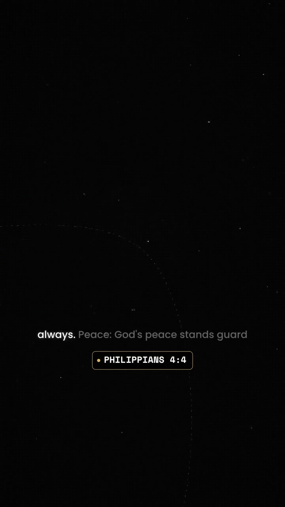 | 0:16.8 · 4.2s | Peace: dove | Peace: dove on a nearly black textured canvas, mint outline … | static |
| 5 | 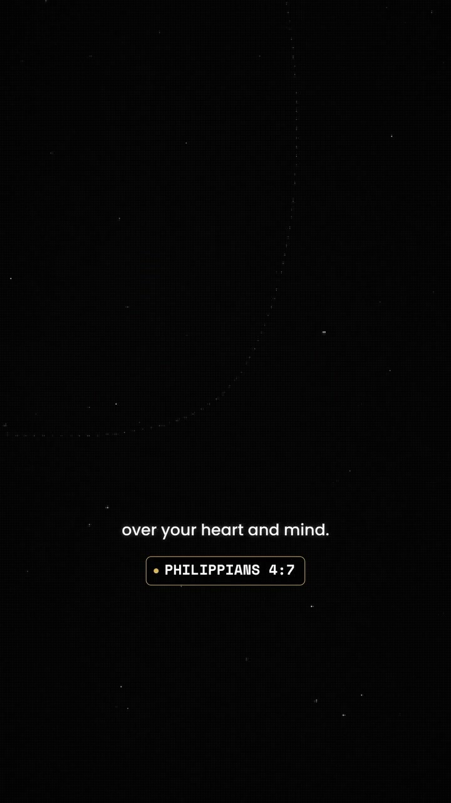 | 0:20.9 · 3.2s | Patience: rotating hourglass | Patience: rotating hourglass on a nearly black textured canv… | static |
| 6 | 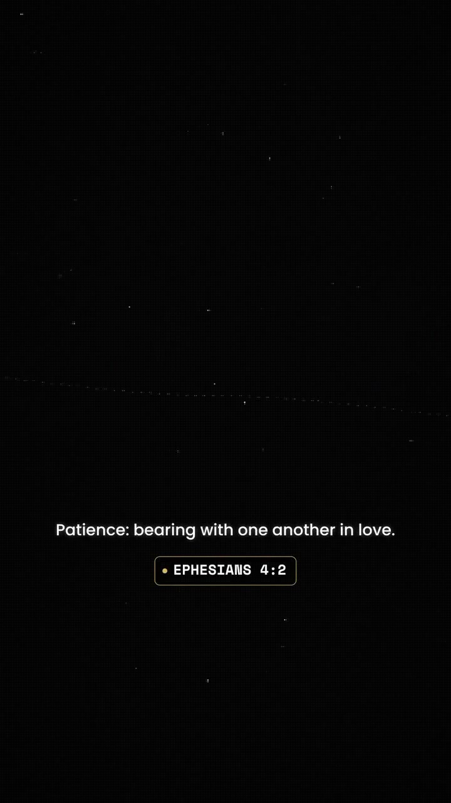 | 0:24.1 · 5.0s | Kindness: smiling face | Kindness: smiling face on a nearly black textured canvas, mi… | static |
| 7 | 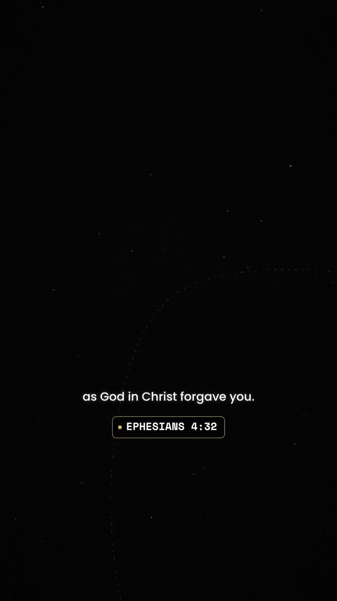 | 0:29.1 · 4.0s | Goodness: hands | Goodness: hands on a nearly black textured canvas, mint outl… | static |
| 8 | 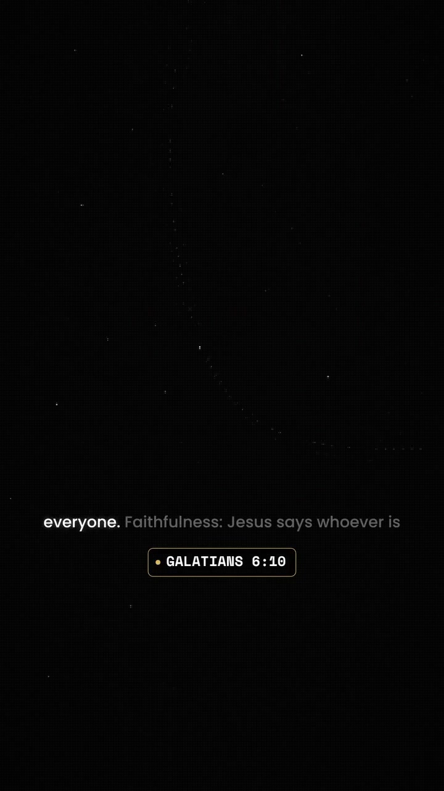 | 0:33.2 · 0.4s | Transition gap | Transition gap on a nearly black textured canvas, mint outli… | static |
| 9 | 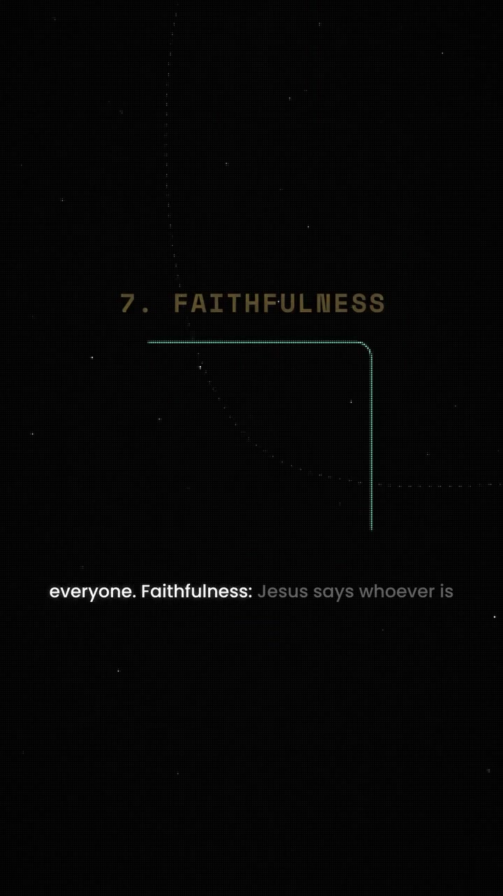 | 0:33.6 · 5.6s | Faithfulness: handshake | Faithfulness: handshake on a nearly black textured canvas, m… | static |
| 10 | 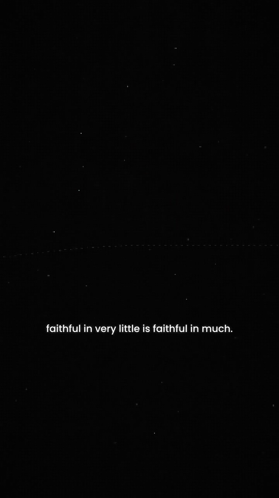 | 0:39.2 · 4.1s | Gentleness: feather | Gentleness: feather on a nearly black textured canvas, mint … | static |
| 11 | 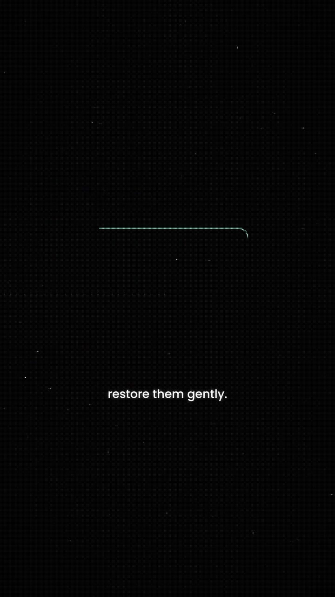 | 0:43.3 · 5.7s | Self-control: figure | Self-control: figure on a nearly black textured canvas, mint… | static |
| 12 | 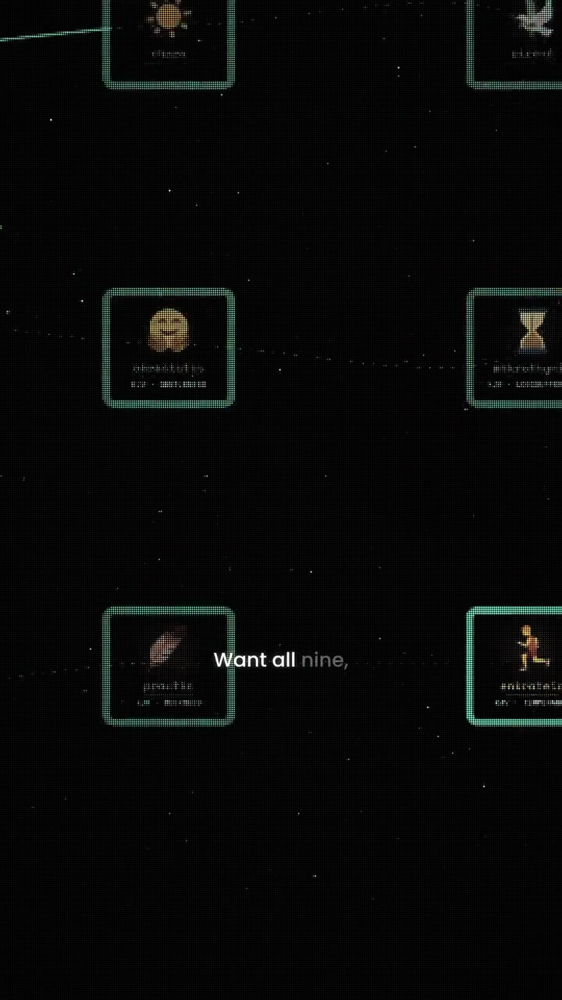 | 0:49.0 · 2.3s | Connected grid pullback | Connected grid pullback on a nearly black textured canvas, m… | smooth move |
| 13 | 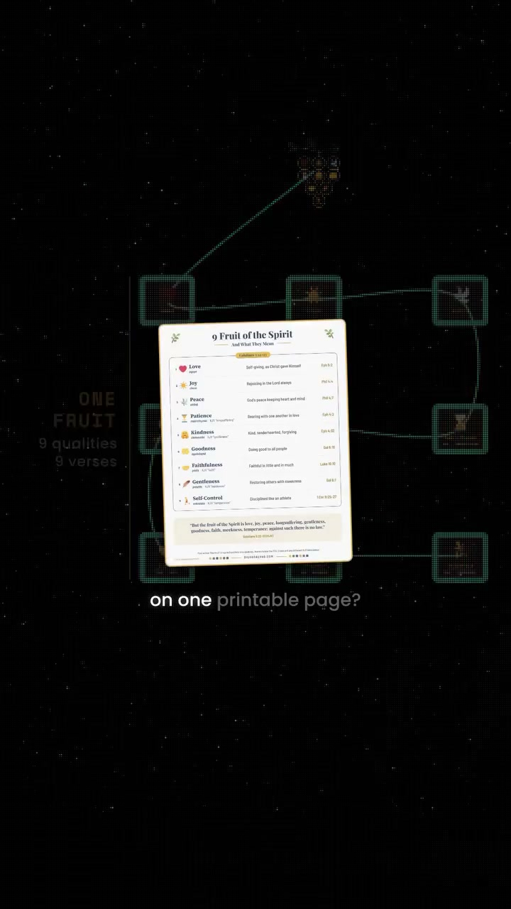 | 0:51.3 · 5.5s | call to action: PDF download call to action | PDF download call to action on a nearly black textured canva… | static |

## Cast, scenes and props

- No cast extracted this time (needs AI image reading)

**Scenes**

| Scene | Where | When | Set / light | Shots |
|---|---|---|---|---|
| S1 | Abstract black graphic canvas | Throughout | Fixed orthographic composition | — |

**Props / products / logos**

- PDF pages: Real document image embedded at end; original file needed only for exact PDF reproduction.

## Camera and lighting

- Visual style: Black grain/halftone, pale mint rounded borders, mustard gold mono headings, centered illustrated symbols; generous negative space.

## Packaging layer (subtitles / styled text / stickers / sound-effect hits)

- SFX hits on: cut ×1
- No overlaid text or stickers detected

- Remake: import `packaging/subtitles.srt` into your editor and put in your own words; the styled version is `packaging/overlays.ass`

## Sound

**Voice**

- male-leaning
- Source: TTS voice-over
- Remake: TTS voice-over: CapCut text-to-speech or another TTS tool, with a similar voice and pace

**Music**

- Tempo: 89 BPM; F major; ending: ends_with_video
- Source: to confirm
- Remake: The original track leans stock library music: search a library by BPM / mood / key for a similar track, or generate a royalty-free track in a similar style with AI

**Sound effects** (10 hits, 6 distinct sounds)

| Sound | Listen | Type | Times used | At | On screen |
|---|---|---|---|---|---|
| F1 | [listen](sfx/sfx_01.wav) | ding | 2 | 6.4s, 11.2s | — |
| F2 | [listen](sfx/sfx_02.wav) | pop | 4 | 22.8s, 38.5s, 39.9s, 42.6s | — |
| F3 | [listen](sfx/sfx_03.wav) | pop | 1 | 26.1s | — |
| F4 | [listen](sfx/sfx_04.wav) | whoosh | 1 | 29.5s | — |
| F5 | [listen](sfx/sfx_05.wav) | pop | 1 | 32.7s | — |
| F6 | [listen](sfx/sfx_06.wav) | pop | 1 | 33.6s | cut |

- Remake: play each sound, find a similar one in your editor's library and place it at the times under “At”

**Listen to the tracks**

<!--stems-->

Sound measurements and evidence

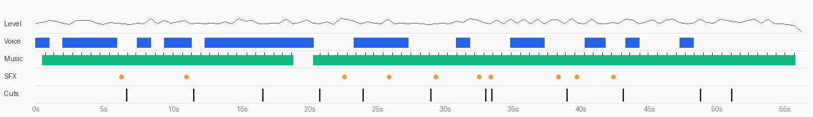

- Loudness -16.5 dBFS, peak -2.1 dBFS
- sound runs across cuts, laid in post as one bed (background changes 4.0dB at cuts vs 4.8dB within shots)
- Voice on 48% of the duration, pitch about 107.6Hz
- Voice source: TTS voice-over (TTS voice-over 64%, human recording 27%, native dialogue from the AI video model 9%)
  - Voice and background sound run across cuts: the voice-over was laid on separately in post (TTS or a human voice-over)
- tempo may also be 44.6/178.2 BPM; music on 95% of the duration (0.5–56.0s); section changes at 17.0s, 24.5s, 34.0s, 44.0s, 48.0s; 17% of cuts land on a beat (chance: about 20%)
- Music source: to confirm (stock library music 52%, AI-generated music 30%, well-known song 17%)
  - The music is a bed under the picture: in a regular video the bed usually comes from a stock library (prior)
  - The voice is speech / narration, not singing (sustained-pitch ratio 0.18): a regular "voice-over + music bed" video
  - Music and video end together: edited to length or custom-made (either source possible, weak evidence)
  - Nothing about this track beyond the format prior and weak cues like the ending (no source heard, no platform music tag): source to confirm; an AI-generated bed cannot be told from a library bed here
  - How to confirm: Check the music tag on the original Douyin / Xiaohongshu / TikTok post: a song title → existing track; "original sound - @creator" → uploaded by the creator (for music videos, usually an AI song)
  - How to confirm: Run it through Shazam / ACRCloud or another song-ID service: a hit means an existing song

## Open questions

- No AI listened to the soundtrack (the review covered the picture only): real voice versus TTS is inferred from the waveform; the effects were found on the separated effects track and their types are estimated from the sound. Play the stems and each effect under “Sound” to check
- music source to confirm: most likely stock library music (52%); how to check is under “Sound”

# Part two · Remake plan

## Remake it yourself: do it in this order

Copy the method and the rhythm, not the pictures: keep what each part does and fill it with your own content and material.

This is a motion-graphics explainer. Do the steps in this order; the detail for each is in the matching subsection below.

1. **Write the content**: write yours in the same 13 steps as the original (narrative line under “Content and structure”)
2. **Voice**: the original is TTS voice-over; record it yourself or use TTS
3. **Motion graphics**: have the agent make an editable first version and change the text and pictures on top of it rather than starting from scratch; the first version is only a start, where it differs from the original is under “Code build”
4. **Subtitles and styled text**: timing and style under “Packaging layer”
5. **Music**: find a track at the same tempo and mood (source: to confirm, about 89 BPM, F major)
6. **Sound effects**: 10; place similar ones from a library at the times under “Sound”
7. **Put it together and compare**: hand the shots you made to the agent; it places them on the original timeline, keeps the original where yours are missing, and renders a side-by-side comparison with the original

### Code build

Rebuild it as one project in an HTML video framework (such as HyperFrames or Remotion): cuts, transitions and each shot's key frames from "Rhythm and key frames", layout, colours and elements from the scenes below. Text and UI are 100% controllable, changing copy is a data change, and an AI coding assistant can write the project.

`rea-video code-remake <breakdown folder>` only makes a quick draft: it renders `code/remake.mp4` from each scene's sampled points / cut-out, motion and background glow and scores it. Particles, point clouds and data visualisations on a dark ground come close; an illustrated character's acting and morph transitions do not.

- Part 1: shots #1–#13 (0.0–56.8s)

Remake assets (all in the report folder; hand them over together with the data below to whoever writes the code, or to an LLM):
- `shots/shot_XXX_first.jpg` / `_last.jpg`: first / last frame of each shot at full size, for layout, type size and margins
- `shots/shot_XXX_strip.jpg`: key frames about every 0.5 s, to follow the animation
- `shots/shot_XXX_elements.jpg` and `_el_NN.jpg` / `_st_NN.jpg` / `_ly_NN.jpg`: full-size crop of every element once settled, numbered as in the motion timeline; redraw shapes from them, cut out icons, logos and illustrations that cannot be redrawn
- `packaging/overlays.ass`, `packaging/timeline.json`: timing, position and colour of the text

How to build the pictures (by the measured picture type):
- particles / point cloud: Three.js particle system (points sampled on the target shape, morph between shapes, bloom), rendered frame by frame with @remotion/three
- vector shapes: SVG shapes + interpolate() / spring() keyframes, positions and timing measured from the frame

Particle shots: what shape the particles form in each shot and how it moves decides whether the remake works; chapter cards, labels and counters go in an HTML layer on top. Build shot by shot from the table below, not one shared background.

| Shot | Time | Build | Picture | Camera | Colours | On-screen text |
|---|---|---|---|---|---|---|
| #1 | 0.0–6.7s | particles / point cloud | Nine fruits overview on a nearly black textured canvas, mint outline card, gold mono heading, white subtitles and scripture badge. | static frame, elements move inside it | ground #000005 · #030208 · drawn #b49864 #453a32 #65736a #cac9c7 | — |
| #2 | 6.7–11.7s | particles / point cloud | Love: heart on a nearly black textured canvas, mint outline card, gold mono heading, white subtitles and scripture badge. | static | ground #000005 · #030208 · drawn #512c2c #64746e #af9c7c #d4d2d4 | — |
| #3 | 11.7–16.8s | particles / point cloud | Joy: sun on a nearly black textured canvas, mint outline card, gold mono heading, white subtitles and scripture badge. | static | ground #020106 · #131011 · drawn #b4864a #413b34 #687872 #d0cdcd | — |
| #4 | 16.8–20.9s | particles / point cloud | Peace: dove on a nearly black textured canvas, mint outline card, gold mono heading, white subtitles and scripture badge. | static | ground #020106 · #0a0b0d #1b1d1d · drawn #3c3c37 #c8c9cc #626e66 #a89c85 | — |
| #5 | 20.9–24.1s | particles / point cloud | Patience: rotating hourglass on a nearly black textured canvas, mint outline card, gold mono heading, white subtitles and scripture badge. | static | ground #020106 · #161415 #2a2d2b · drawn #566567 #3c3933 #d1c5b2 #aa9066 | — |
| #6 | 24.1–29.1s | particles / point cloud | Kindness: smiling face on a nearly black textured canvas, mint outline card, gold mono heading, white subtitles and scripture badge. | static | ground #020106 ·  · drawn #807255 #c4a15c #413c34 #cdcbcd | — |
| #7 | 29.1–33.2s | particles / point cloud | Goodness: hands on a nearly black textured canvas, mint outline card, gold mono heading, white subtitles and scripture badge. | static | ground #020106 · #161312 #202522 · drawn #caad61 #403c32 #767b6e #d0ced1 | — |
| #8 | 33.2–33.6s | particles / point cloud | Transition gap on a nearly black textured canvas, mint outline card, gold mono heading, white subtitles and scripture badge. | static | ground #020106 ·  · drawn #39332f #535153 #d1cfd2 #868385 | — |
| #9 | 33.6–39.2s | particles / point cloud | Faithfulness: handshake on a nearly black textured canvas, mint outline card, gold mono heading, white subtitles and scripture badge. | static | ground #000005 · #030208 · drawn #403e37 #c7a65d #74796c #cdcbcd | — |
| #10 | 39.2–43.3s | particles / point cloud | Gentleness: feather on a nearly black textured canvas, mint outline card, gold mono heading, white subtitles and scripture badge. | static | ground #020104 · #020106 · drawn #403931 #696960 #b09679 #d4d1d4 | — |
| #11 | 43.3–49.0s | particles / point cloud | Self-control: figure on a nearly black textured canvas, mint outline card, gold mono heading, white subtitles and scripture badge. | static | ground #020106 · #0a0b0d · drawn #443c32 #737566 #bca375 #d3d0d3 | — |
| #12 | 49.0–51.3s | particles / point cloud | Connected grid pullback on a nearly black textured canvas, mint outline card, gold mono heading, white subtitles and scripture badge. | pull out 5%/s, picture drifts down | ground #020106 · #cfd0d2 #131312 #1d2723 #bebebe · drawn #518076 #d1cfcf #37403b #988b72 | — |
| #13 | 51.3–56.8s | vector shapes | PDF download call to action on a nearly black textured canvas, mint outline card, gold mono heading, white subtitles and scripture badge. | static | ground #020002 · #fafbfc #eae8e5 #171a18 #574833 · drawn #fbf8f8 #d1c2a6 | — |

**Picture scenes** (a new scene whenever what is drawn moves or changes shape as a whole inside a shot. `frames/` holds first / middle / last full-size frames per scene, `scene_XX_layer.png` the drawn layer of the middle frame (background and text removed, alpha by how strongly it stands out), `frames/points/scene_XX.json` samples of that layer, one `x y r g b a` per row with x, y in 0–1. Place particles, trace lines or redraw shapes from these instead of guessing from a description. `track` in `frames/scenes.json` follows the layer's centre and spread over time)

| Scene | Shot | Time | Ground | Background glow | Drawn colours | Pieces | Area (x0 y0 x1 y1) | Motion |
|---|---|---|---|---|---|---|---|---|
| scene_01 | #1 | 0.0–6.7s | #040404 | #3a3324, centre (0.55, 0.44), radius 0.21 | #525042 #ab9d70 #d8d8ce | 180 | 0.25 0.19 0.73 0.71 | near still |
| scene_02 | #2 | 6.7–11.7s | #040404 | #151514, centre (0.50, 0.56), radius 0.24 | #492c2b #68665b #c2c5b0 | 108 | 0.25 0.32 0.75 0.71 | zoom in 1%/s |
| scene_03 | #3 | 11.7–16.8s | #040404 | #2e2417, centre (0.51, 0.54), radius 0.17 | #a6946a #4d4d3d #e0e0df | 98 | 0.26 0.32 0.76 0.73 | near still |
| scene_04 | #4 | 16.8–20.9s | #040404 | #2f312f, centre (0.51, 0.47), radius 0.13 | #464c43 #9a9f8b #d5d8d8 | 133 | 0.18 0.32 0.80 0.72 | near still |
| scene_05 | #5 | 20.9–24.1s | #040404 | #332f27, centre (0.49, 0.48), radius 0.15 | #474c46 #a99d75 #dad6c1 | 190 | 0.18 0.32 0.77 0.71 | zoom in 1%/s |
| scene_06 | #6 | 24.1–29.1s | #040404 | #4b3d23, centre (0.51, 0.46), radius 0.14 | #b8a167 #575442 #dbdcda | 163 | 0.22 0.32 0.75 0.71 | near still |
| scene_07 | #7 | 29.1–33.2s | #040404 | #494126, centre (0.51, 0.47), radius 0.13 | #beaf6c #4c5143 #e0e0df | 133 | 0.20 0.32 0.76 0.71 | near still |
| scene_08 | #8 | 33.2–33.6s | #040404 | #10100f, centre (0.43, 0.69), radius 0.18 | #62615e #363535 #dadad9 | 116 | 0.11 0.45 0.88 0.73 | near still |
| scene_09 | #9 | 33.6–39.2s | #040404 | #38311e, centre (0.49, 0.46), radius 0.14 | #b8a970 #494c40 #e0e0e0 | 112 | 0.15 0.32 0.83 0.71 | near still |
| scene_10 | #10 | 39.2–43.3s | #040404 | #261e1b, centre (0.49, 0.53), radius 0.25 | #49493f #aa9c7e #e1e0e0 | 136 | 0.24 0.32 0.74 0.71 | zoom in 1%/s |
| scene_11 | #11 | 43.3–49.0s | #040404 | #211c16, centre (0.51, 0.56), radius 0.29 | #4e4b3e #aaa17c #e4e3e3 | 173 | 0.21 0.33 0.79 0.73 | pans (+0.7%, +0.2%)/s |
| scene_12 | #12 | 49.0–51.3s | #040404 | #1a1f1c, centre (0.60, 0.49), radius 0.38 | #354239 #578570 #94b9a3 | 1475 | 0.27 0.18 0.95 0.67 | zoom out 11%/s, pans (+2.4%, +0.5%)/s |
| scene_13 | #13 | 51.3–56.8s | #010101 | #eaeae9, centre (0.50, 0.48), radius 0.23 | #f9f9f7 #c0af84 #373e38 | 289 | 0.32 0.20 0.91 0.67 | near still |

When built, score it with `rea-video compare original remake --scenes frames/scenes.json -o dir` (each side's drawn layer is taken against its own ground, so a new ground colour still compares) and fix the lowest-scoring scenes first, from `compare_worst.jpg`.

Per-shot motion timeline (measured: positions in % of frame width / height, colours sampled once the element settles; read together with the key-frame strip)

Motion #1 0.0–6.7s · 7 events

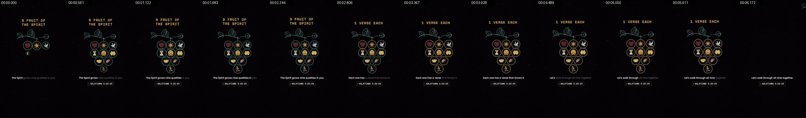

- Ground #000005; other main colours #030208; drawn layer #b49864 #453a32 #65736a #cac9c7
Element crops (numbers match the motion list below; L = the continuously moving layer mid-shot and at the end, S = elements that never move), full-size files in `shots/`:

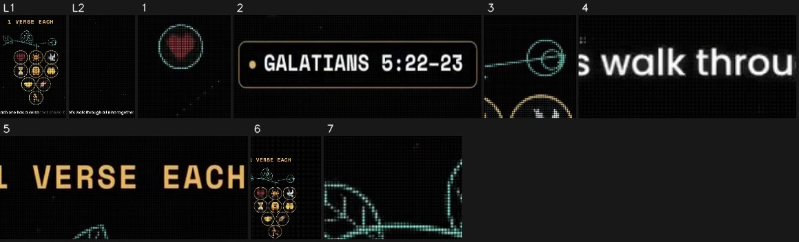

- [crop L1](shots/shot_001_ly_01.jpg) [crop L2](shots/shot_001_ly_02.jpg) · Continuous layer: 11% of the frame moves through the whole shot (x 22%–80%, y 18%–68%), e.g. drifting gradients, particle flow, breathing glow
1. 0.07–6.33s · middle (x 33%–51%, y 36%–46%) · disappears, unfolds downward (draw-on / grow / wipe), ease-out · #282227 · [crop](shots/shot_001_el_01.jpg)
2. 0.33–0.60s · bottom (x 31%–69%, y 69%–74%) · appears, linear · #343133 · [crop](shots/shot_001_el_02.jpg)
3. 3.93–6.40s · top (x 58%–73%, y 26%–35%) · disappears, moves rightward, ease-in · #2e3b36 · [crop](shots/shot_001_el_03.jpg)
4. 5.07–5.27s · middle (x 27%–44%, y 65%–68%) · appears, ease-in-out · #4f4d50 · [crop](shots/shot_001_el_04.jpg)
5. 5.67–6.40s · top (x 31%–69%, y 16%–22%) · disappears, unfolds downward (draw-on / grow / wipe), ease-in · #735834 · [crop](shots/shot_001_el_05.jpg)
6. 6.07–6.47s · middle (x 31%–100%, y 6%–61%) · disappears, moves rightward, ease-in · #4b4132 · [crop](shots/shot_001_el_06.jpg)
7. 6.07–6.33s · top (x 27%–40%, y 24%–28%) · disappears, moves rightward, ease-in-out · #363c3e · [crop](shots/shot_001_el_07.jpg)

Motion #2 6.7–11.7s (slide in) · 5 events

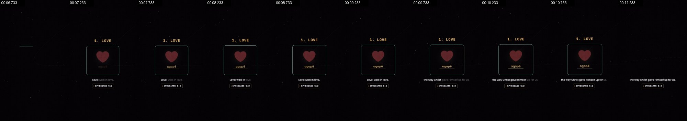

- Ground #000005; other main colours #030208; drawn layer #512c2c #64746e #af9c7c #d4d2d4
Element crops (numbers match the motion list below; L = the continuously moving layer mid-shot and at the end, S = elements that never move), full-size files in `shots/`:

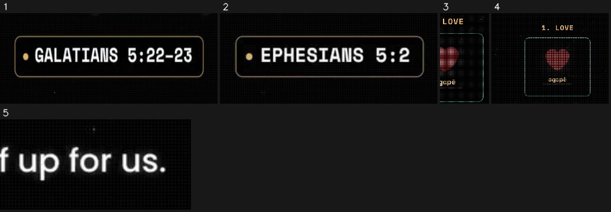

- Continuous layer: 3% of the frame moves through the whole shot (x 24%–76%, y 31%–67%), e.g. drifting gradients, particle flow, breathing glow
1. 6.93–7.00s · bottom (x 29%–71%, y 69%–74%) · disappears, instant · #342d2a · [crop](shots/shot_002_el_01.jpg)
2. 7.20–7.47s · bottom (x 33%–67%, y 69%–74%) · appears, linear · #342b2a · [crop](shots/shot_002_el_02.jpg)
3. 9.73–11.20s · middle (x 49%–78%, y 31%–61%) · disappears, moves rightward, ease-in-out · #5b2529 · [crop](shots/shot_002_el_03.jpg)
4. 10.60–11.40s · middle (x 0%–89%, y 28%–64%) · disappears, unfolds leftward (draw-on / grow / wipe), ease-in · #592528 · [crop](shots/shot_002_el_04.jpg)
5. 10.80–11.07s · middle right (x 67%–84%, y 65%–68%) · appears, unfolds rightward (draw-on / grow / wipe), ease-out · #565457 · [crop](shots/shot_002_el_05.jpg)

Motion #3 11.7–16.8s (slide in) · 6 events

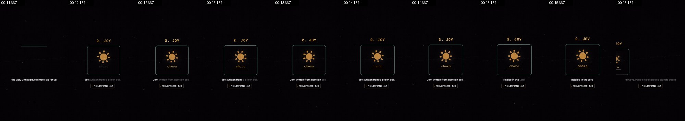

- Ground #020106; other main colours #131011; drawn layer #b4864a #413b34 #687872 #d0cdcd
Element crops (numbers match the motion list below; L = the continuously moving layer mid-shot and at the end, S = elements that never move), full-size files in `shots/`:

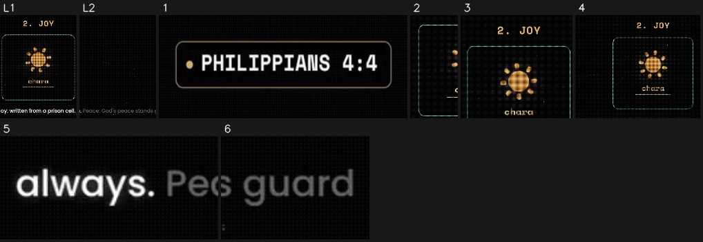

- [crop L1](shots/shot_003_ly_01.jpg) [crop L2](shots/shot_003_ly_02.jpg) · Continuous layer: 4% of the frame moves through the whole shot (x 27%–76%, y 31%–67%), e.g. drifting gradients, particle flow, breathing glow
1. 12.13–12.40s · bottom (x 31%–69%, y 69%–74%) · appears, ease-out · #322b29 · [crop](shots/shot_003_el_01.jpg)
2. 13.93–16.40s · middle (x 24%–44%, y 36%–61%) · disappears, scales up, ease-in-out · #3b4b49 · [crop](shots/shot_003_el_02.jpg)
3. 14.93–16.33s · middle (x 24%–76%, y 30%–55%) · disappears, moves leftward, ease-in · #515939 · [crop](shots/shot_003_el_03.jpg)
4. 16.07–16.47s · middle (x 0%–78%, y 30%–64%) · disappears, moves leftward, ease-in-out · #3d4437 · [crop](shots/shot_003_el_04.jpg)
5. 16.40–16.47s · middle left (x 13%–31%, y 65%–68%) · appears, instant · #454346 · [crop](shots/shot_003_el_05.jpg)
6. 16.40–16.47s · middle right (x 76%–87%, y 65%–68%) · appears, instant · #323033 · [crop](shots/shot_003_el_06.jpg)

Motion #4 16.8–20.9s (slide in) · 4 events

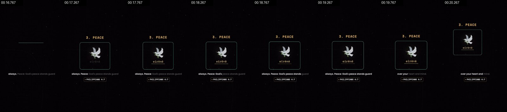

- Ground #020106; other main colours #0a0b0d #1b1d1d; drawn layer #3c3c37 #c8c9cc #626e66 #a89c85
Element crops (numbers match the motion list below; L = the continuously moving layer mid-shot and at the end, S = elements that never move), full-size files in `shots/`:

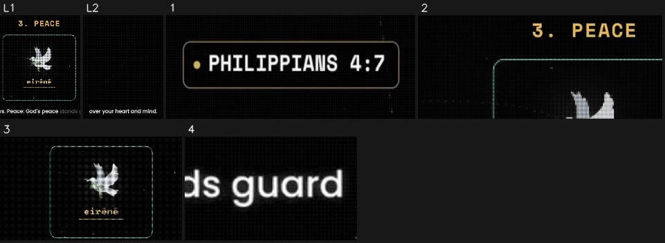

- [crop L1](shots/shot_004_ly_01.jpg) [crop L2](shots/shot_004_ly_02.jpg) · Continuous layer: 4% of the frame moves through the whole shot (x 24%–76%, y 31%–67%), e.g. drifting gradients, particle flow, breathing glow
1. 16.90–17.43s · bottom (x 31%–69%, y 69%–74%) · changes, ease-in · #535154 · [crop](shots/shot_004_el_01.jpg)
2. 18.17–20.57s · middle (x 7%–69%, y 32%–45%) · disappears, moves rightward, ease-in-out · #485e57 · [crop](shots/shot_004_el_02.jpg)
3. 18.70–20.50s · middle (x 2%–87%, y 36%–61%) · disappears, moves leftward, ease-in-out · #3c433e · [crop](shots/shot_004_el_03.jpg)
4. 19.83–19.90s · middle right (x 73%–87%, y 65%–68%) · disappears, instant · #636164 · [crop](shots/shot_004_el_04.jpg)

Motion #5 20.9–24.1s (slide in) · 4 events

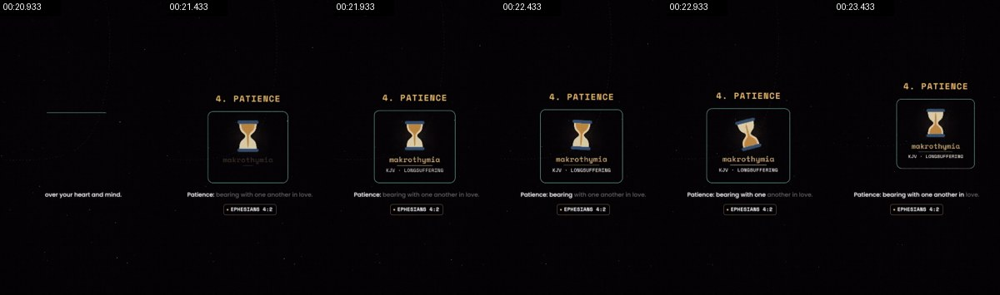

- Ground #020106; other main colours #161415 #2a2d2b; drawn layer #566567 #3c3933 #d1c5b2 #aa9066
Element crops (numbers match the motion list below; L = the continuously moving layer mid-shot and at the end, S = elements that never move), full-size files in `shots/`:

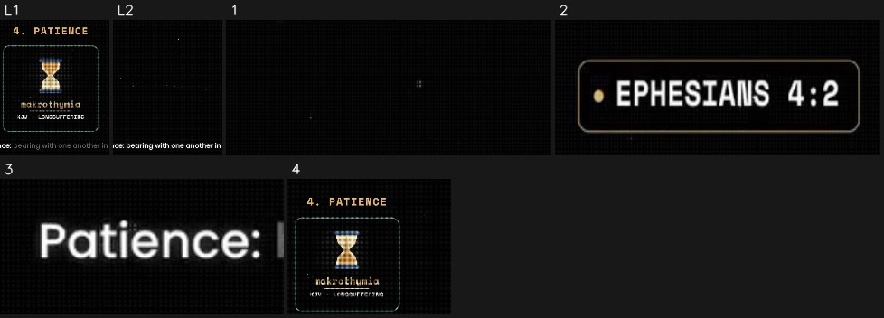

- [crop L1](shots/shot_005_ly_01.jpg) [crop L2](shots/shot_005_ly_02.jpg) · Continuous layer: 6% of the frame moves through the whole shot (x 24%–78%, y 31%–67%), e.g. drifting gradients, particle flow, breathing glow
1. 21.07–21.13s · bottom (x 31%–69%, y 69%–74%) · disappears, instant · #372c2a · [crop](shots/shot_005_el_01.jpg)
2. 21.40–21.67s · bottom (x 33%–67%, y 69%–73%) · appears, linear · #5d5b5e · [crop](shots/shot_005_el_02.jpg)
3. 21.67–21.73s · middle left (x 11%–29%, y 65%–68%) · appears, instant · #59575a · [crop](shots/shot_005_el_03.jpg)
4. 23.47–23.87s · middle (x 22%–100%, y 28%–61%) · disappears, moves rightward, linear · #434940 · [crop](shots/shot_005_el_04.jpg)

Motion #6 24.1–29.1s (slide in) · 3 events

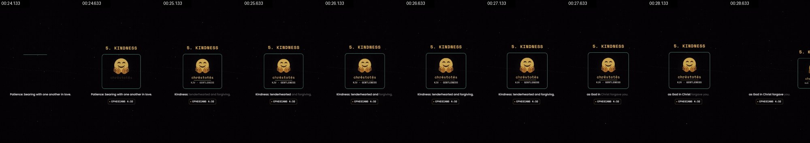

- Ground #020106; other main colours —; drawn layer #807255 #c4a15c #413c34 #cdcbcd
Element crops (numbers match the motion list below; L = the continuously moving layer mid-shot and at the end, S = elements that never move), full-size files in `shots/`:

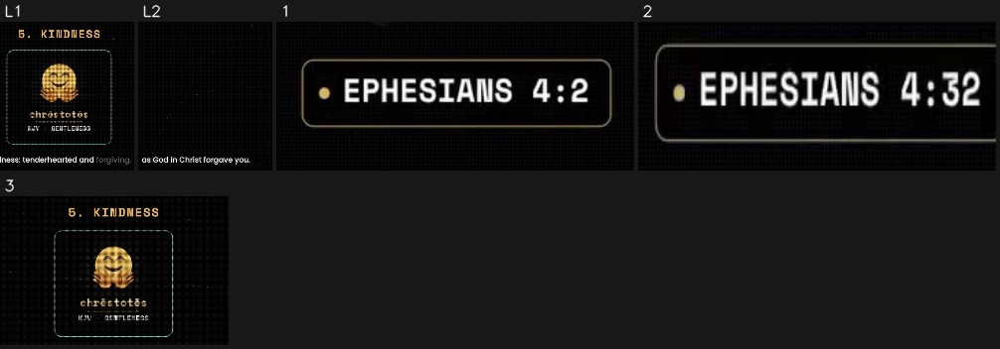

- [crop L1](shots/shot_006_ly_01.jpg) [crop L2](shots/shot_006_ly_02.jpg) · Continuous layer: 6% of the frame moves through the whole shot (x 24%–84%, y 31%–67%), e.g. drifting gradients, particle flow, breathing glow
1. 24.33–24.40s · bottom (x 33%–67%, y 69%–74%) · disappears, instant · #342c2a · [crop](shots/shot_006_el_01.jpg)
2. 24.60–24.87s · bottom (x 33%–64%, y 70%–72%) · appears, linear · #7d7b7d · [crop](shots/shot_006_el_02.jpg)
3. 28.07–28.93s · middle (x 4%–100%, y 30%–62%) · disappears, moves rightward, ease-in · #554e34 · [crop](shots/shot_006_el_03.jpg)

Motion #7 29.1–33.2s (slide in) · 6 events

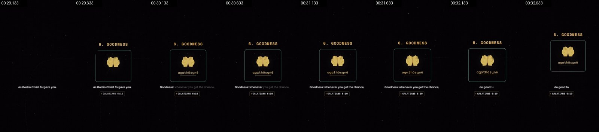

- Ground #020106; other main colours #161312 #202522; drawn layer #caad61 #403c32 #767b6e #d0ced1
Element crops (numbers match the motion list below; L = the continuously moving layer mid-shot and at the end, S = elements that never move), full-size files in `shots/`:

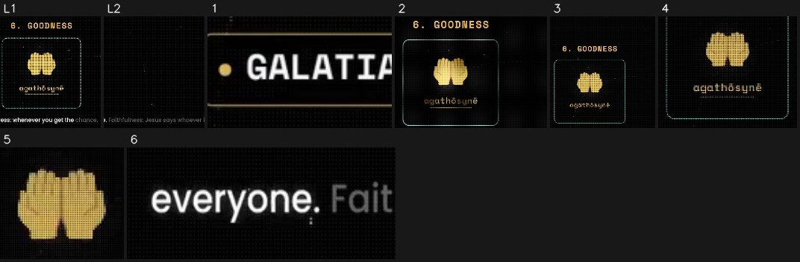

- [crop L1](shots/shot_007_ly_01.jpg) [crop L2](shots/shot_007_ly_02.jpg) · Continuous layer: 5% of the frame moves through the whole shot (x 27%–87%, y 31%–67%), e.g. drifting gradients, particle flow, breathing glow
1. 29.67–29.93s · bottom (x 36%–49%, y 70%–72%) · appears, linear · #848285 · [crop](shots/shot_007_el_01.jpg)
2. 30.60–32.93s · middle (x 24%–100%, y 32%–61%) · disappears, moves leftward, ease-in-out · #665e4d · [crop](shots/shot_007_el_02.jpg)
3. 32.07–33.07s · middle (x 24%–96%, y 21%–62%) · disappears, moves rightward, ease-in · #5c6147 · [crop](shots/shot_007_el_03.jpg)
4. 32.93–33.07s · top (x 42%–87%, y 0%–20%) · appears, unfolds downward (draw-on / grow / wipe), instant · #473c34 · [crop](shots/shot_007_el_04.jpg)
5. 33.07–33.13s · top (x 56%–73%, y 2%–10%) · appears, instant · #b69950 · [crop](shots/shot_007_el_05.jpg)
6. 33.07–33.13s · middle left (x 9%–33%, y 65%–68%) · appears, instant · #474548 · [crop](shots/shot_007_el_06.jpg)

Motion #8 33.2–33.6s (slide in) · 2 events

- Ground #020106; other main colours —; drawn layer #39332f #535153 #d1cfd2 #868385
Element crops (numbers match the motion list below; L = the continuously moving layer mid-shot and at the end, S = elements that never move), full-size files in `shots/`:

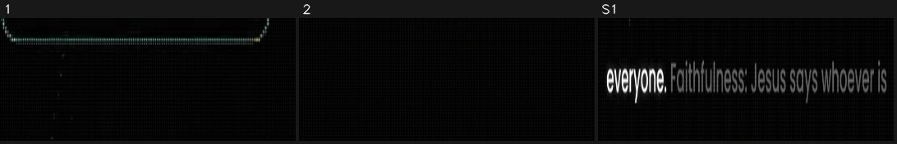

- S1. never moves: horizontal line · x 9%–91%, y 65%–68% · #585659 · [crop](shots/shot_008_st_01.jpg)
1. 33.23–33.30s · top (x 36%–82%, y 0%–5%) · disappears, instant · #1a1f1f · [crop](shots/shot_008_el_01.jpg)
2. 33.50–33.57s · bottom (x 31%–69%, y 69%–74%) · disappears, instant · #332c25 · [crop](shots/shot_008_el_02.jpg)

Motion #9 33.6–39.2s (slide in) · 7 events

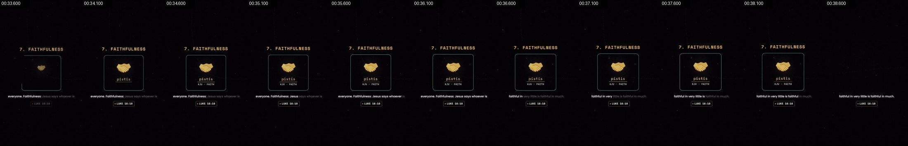

- Ground #000005; other main colours #030208; drawn layer #403e37 #c7a65d #74796c #cdcbcd
Element crops (numbers match the motion list below; L = the continuously moving layer mid-shot and at the end, S = elements that never move), full-size files in `shots/`:

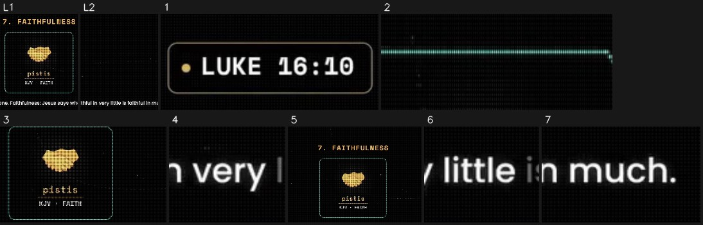

- [crop L1](shots/shot_009_ly_01.jpg) [crop L2](shots/shot_009_ly_02.jpg) · Continuous layer: 5% of the frame moves through the whole shot (x 22%–76%, y 31%–67%), e.g. drifting gradients, particle flow, breathing glow
1. 33.80–34.07s · bottom (x 38%–62%, y 69%–73%) · appears, linear · #535154 · [crop](shots/shot_009_el_01.jpg)
2. 35.33–35.60s · middle (x 33%–71%, y 38%–39%) · disappears, linear · #3b5e58 · [crop](shots/shot_009_el_02.jpg)
3. 35.87–38.73s · middle (x 22%–98%, y 39%–61%) · disappears, moves leftward, ease-in-out · #62554a · [crop](shots/shot_009_el_03.jpg)
4. 37.07–37.13s · middle (x 33%–42%, y 65%–68%) · appears, instant · #716f72 · [crop](shots/shot_009_el_04.jpg)
5. 37.27–38.80s · middle (x 0%–100%, y 25%–62%) · disappears, moves leftward, ease-in · #3a4138 · [crop](shots/shot_009_el_05.jpg)
6. 37.40–37.47s · middle (x 42%–51%, y 65%–68%) · appears, instant · #5e5c5f · [crop](shots/shot_009_el_06.jpg)
7. 38.87–38.93s · middle right (x 71%–84%, y 65%–68%) · appears, instant · #504e51 · [crop](shots/shot_009_el_07.jpg)

Motion #10 39.2–43.3s (slide in) · 3 events

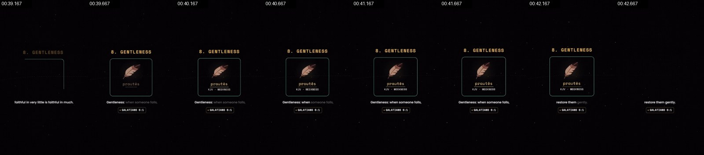

- Ground #020104; other main colours #020106; drawn layer #403931 #696960 #b09679 #d4d1d4
Element crops (numbers match the motion list below; L = the continuously moving layer mid-shot and at the end, S = elements that never move), full-size files in `shots/`:

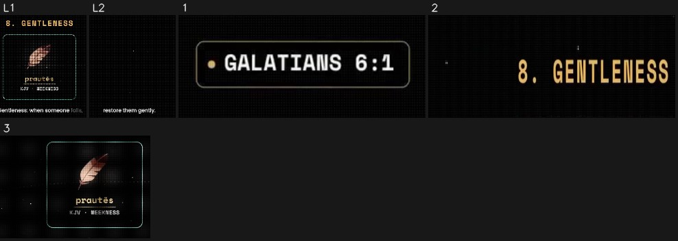

- [crop L1](shots/shot_010_ly_01.jpg) [crop L2](shots/shot_010_ly_02.jpg) · Continuous layer: 6% of the frame moves through the whole shot (x 24%–80%, y 31%–67%), e.g. drifting gradients, particle flow, breathing glow
1. 39.57–39.77s · bottom (x 33%–67%, y 69%–74%) · appears, linear · #2d2a2a · [crop](shots/shot_010_el_01.jpg)
2. 42.23–42.83s · top (x 0%–73%, y 29%–35%) · disappears, moves leftward, ease-in · #7d6139 · [crop](shots/shot_010_el_02.jpg)
3. 42.43–42.83s · middle (x 0%–78%, y 36%–64%) · disappears, moves leftward, ease-in-out · #333733 · [crop](shots/shot_010_el_03.jpg)

Motion #11 43.3–49.0s (slide in) · 9 events

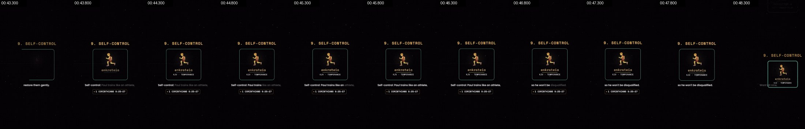

- Ground #020106; other main colours #0a0b0d; drawn layer #443c32 #737566 #bca375 #d3d0d3
Element crops (numbers match the motion list below; L = the continuously moving layer mid-shot and at the end, S = elements that never move), full-size files in `shots/`:

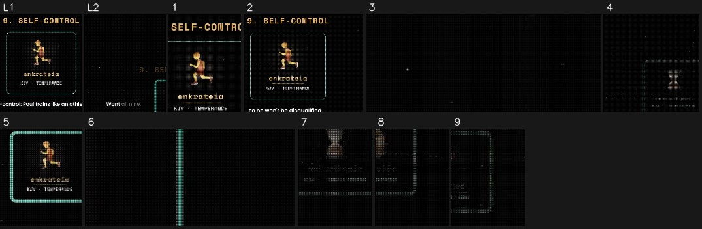

- [crop L1](shots/shot_011_ly_01.jpg) [crop L2](shots/shot_011_ly_02.jpg) · Continuous layer: 5% of the frame moves through the whole shot (x 24%–78%, y 32%–68%), e.g. drifting gradients, particle flow, breathing glow
1. 45.83–48.57s · middle (x 36%–71%, y 31%–57%) · disappears, moves downward, ease-in-out · #343126 · [crop](shots/shot_011_el_01.jpg)
2. 47.90–48.83s · middle (x 24%–100%, y 32%–65%) · disappears, moves downward, ease-in-out · #333223 · [crop](shots/shot_011_el_02.jpg)
3. 47.90–48.77s · bottom (x 29%–71%, y 69%–74%) · disappears, moves rightward, ease-in-out · #383639 · [crop](shots/shot_011_el_03.jpg)
4. 47.97–48.83s · top right (x 53%–100%, y 0%–26%) · appears, slides downward, ease-in · #222524 · [crop](shots/shot_011_el_04.jpg)
5. 48.03–48.90s · middle right (x 69%–100%, y 57%–76%) · appears, slides rightward, ease-in · #354136 · [crop](shots/shot_011_el_05.jpg)
6. 48.43–48.90s · middle right (x 76%–100%, y 52%–56%) · disappears, moves rightward, ease-in · #040306 · [crop](shots/shot_011_el_06.jpg)
7. 48.50–48.90s · top right (x 76%–100%, y 18%–34%) · appears, slides downward, ease-in · #1f2322 · [crop](shots/shot_011_el_07.jpg)
8. 48.77–48.90s · top left (x 0%–24%, y 18%–34%) · appears, slides rightward, instant · #232421 · [crop](shots/shot_011_el_08.jpg)
9. 48.77–48.90s · middle left (x 0%–24%, y 57%–74%) · appears, slides rightward, instant · #1f2324 · [crop](shots/shot_011_el_09.jpg)

Motion #12 49.0–51.3s (zoom in) · 12 events

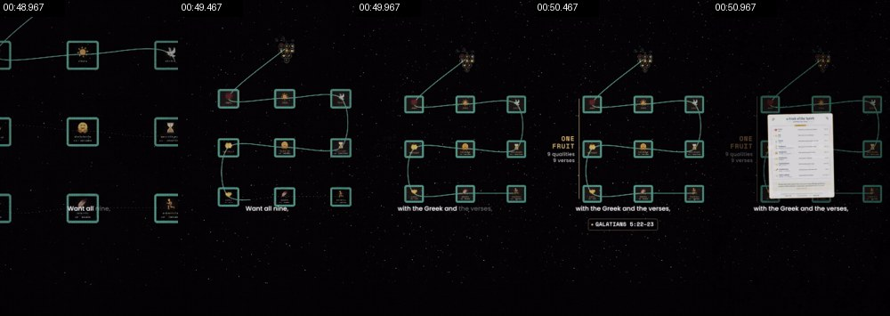

- Ground #020106; other main colours #cfd0d2 #131312 #1d2723 #bebebe; drawn layer #518076 #d1cfcf #37403b #988b72
Element crops (numbers match the motion list below; L = the continuously moving layer mid-shot and at the end, S = elements that never move), full-size files in `shots/`:

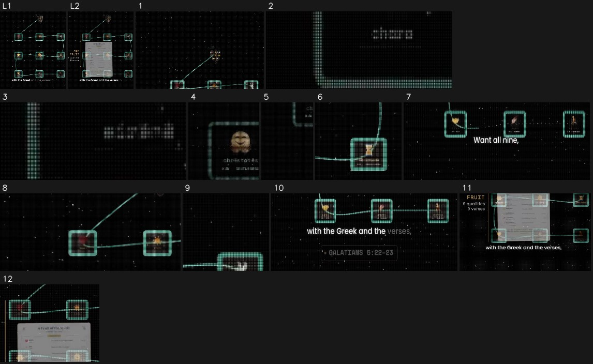

- [crop L1](shots/shot_012_ly_01.jpg) [crop L2](shots/shot_012_ly_02.jpg) · Continuous layer: 11% of the frame moves through the whole shot (x 9%–96%, y 15%–71%), e.g. drifting gradients, particle flow, breathing glow
1. 49.03–50.03s · top (x 0%–100%, y 0%–32%) · changes, moves downward, ease-out · #050407 · [crop](shots/shot_012_el_01.jpg)
2. 49.03–49.23s · top left (x 7%–33%, y 0%–4%) · disappears, ease-out · #1f2727 · [crop](shots/shot_012_el_02.jpg)
3. 49.03–49.10s · top right (x 80%–98%, y 0%–2%) · disappears, instant · #1e2323 · [crop](shots/shot_012_el_03.jpg)
4. 49.03–49.17s · top left (x 7%–31%, y 24%–38%) · disappears, moves rightward, instant · #292d27 · [crop](shots/shot_012_el_04.jpg)
5. 49.03–49.63s · middle left (x 0%–20%, y 35%–50%) · disappears, moves leftward, ease-in-out · #232e2d · [crop](shots/shot_012_el_05.jpg)
6. 49.03–50.10s · middle right (x 76%–100%, y 40%–50%) · appears, slides rightward, ease-out · #36433f · [crop](shots/shot_012_el_06.jpg)
7. 49.03–49.57s · middle (x 2%–100%, y 59%–74%) · changes, moves rightward, ease-out · #050507 · [crop](shots/shot_012_el_07.jpg)
8. 49.30–50.10s · top (x 2%–69%, y 24%–38%) · appears, slides rightward, ease-out · #2b322e · [crop](shots/shot_012_el_08.jpg)
9. 49.30–50.03s · top right (x 78%–96%, y 24%–31%) · appears, slides rightward, ease-in-out · #203933 · [crop](shots/shot_012_el_09.jpg)
10. 49.30–50.17s · middle (x 7%–100%, y 59%–74%) · changes, ease-out · #1f1b1b · [crop](shots/shot_012_el_10.jpg)
11. 50.97–51.23s · middle (x 7%–96%, y 46%–74%) · appears, slides upward, ease-in-out · #d9d5d2 · [crop](shots/shot_012_el_11.jpg)
12. 51.03–51.23s · middle (x 24%–71%, y 28%–46%) · appears, linear · #dedbdd · [crop](shots/shot_012_el_12.jpg)

Motion #13 51.3–56.8s · 3 events

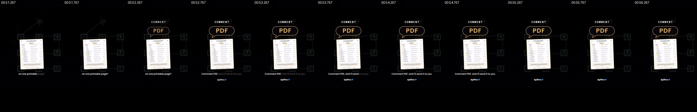

- Ground #020002; other main colours #fafbfc #eae8e5 #171a18 #574833; drawn layer #fbf8f8 #d1c2a6
Element crops (numbers match the motion list below; L = the continuously moving layer mid-shot and at the end, S = elements that never move), full-size files in `shots/`:

1. 51.33–51.60s · middle (x 7%–96%, y 18%–65%) · changes, ease-out · #f9f5f2 · [crop](shots/shot_013_el_01.jpg)
2. 52.40–53.53s · top (x 29%–71%, y 19%–35%) · appears, slides downward, linear · #615232 · [crop](shots/shot_013_el_02.jpg)
3. 52.73–53.20s · bottom (x 42%–58%, y 70%–72%) · appears, linear · #606e78 · [crop](shots/shot_013_el_03.jpg)

### Edit

- Cut in the order and lengths of the shot list
- Approach: 0.4–0.9 second slide/rotation exits; approximately 3–6 second cards; final connected grid zoom-out.
- Rhythm: 12.7 cuts per minute, 4.37s average shot; no live-action shots; transitions cut×1, slide×10, zoom transition×1

**Transitions**

| Time | Into shot | Transition |
|---|---|---|
| 6.3–7.2s | #2 | slide, 0.9s |
| 11.2–12.1s | #3 | slide, 0.9s |
| 16.3–17.2s | #4 | slide, 1.0s |
| 20.4–21.4s | #5 | slide, 1.0s |
| 23.7–24.5s | #6 | slide, 0.8s |
| 28.8–29.4s | #7 | slide, 0.6s |
| 32.8–33.5s | #8 | slide, 0.7s |
| 33.5–33.6s | #9 | slide, 0.1s |
| 38.5–39.8s | #10 | slide, 1.2s |
| 42.6–43.9s | #11 | slide, 1.3s |
| 48.6–49.3s | #12 | zoom transition, 0.7s |

## Appendix

### Shot by shot

Each shot has two parts: what is visible on screen, and how the tools infer it was made (with the basis); remake prompts last. Folded by default.

#1 00:00.000–00:06.733 · code / template render

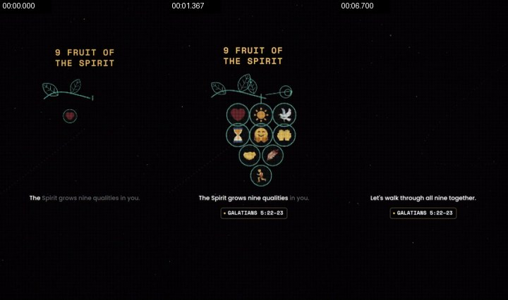

**Visible on screen** (check against the frames)
- Picture: Nine fruits overview on a nearly black textured canvas, mint outline card, gold mono heading, white subtitles and scripture badge.
- [AI assistant review] Stable card geometry and typography across frames.
- [AI assistant review] Illustrated icons undergo rigid transforms; no live camera footage visible.

**How it was made, as inferred by the tools** (inferred, not seen)
- Inference: code / template render 86%, 2D animation 6%, 3D render 3% (fused_agent)
- Material: rendered by the creator
- Basis (tool measurements, not necessarily visible to the eye):
  - On a dark ground the lit part is almost all fine dots / thin lines (only 5% of lit pixels shade gently, 19 bright peaks per 100 lit pixels): particle / point-cloud / wireframe graphics, not a shaded photo, 3D surface or AI picture
  - Rendered texture: 0% flat colour blocks, 95% of pixels use only 13 colours, 20% axis-aligned edges

- Remake: Code render: rebuild in an HTML video framework (such as HyperFrames or Remotion) from the rhythm, key frames and layout, 100% controllable, no generative model needed

#2 00:06.733–00:11.667 · code / template render

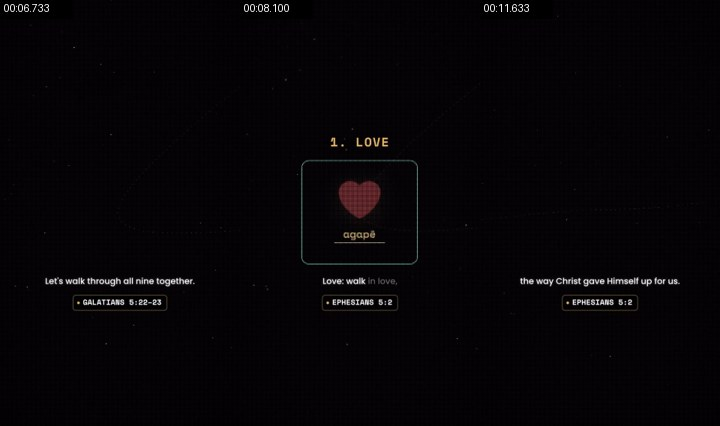

**Visible on screen** (check against the frames)
- Picture: Love: heart on a nearly black textured canvas, mint outline card, gold mono heading, white subtitles and scripture badge.
- [AI assistant review] Stable card geometry and typography across frames.
- [AI assistant review] Illustrated icons undergo rigid transforms; no live camera footage visible.

**How it was made, as inferred by the tools** (inferred, not seen)
- Inference: code / template render 88%, 2D animation 5%, 3D render 2% (fused_agent)
- Material: rendered by the creator
- Basis (tool measurements, not necessarily visible to the eye):
  - 74% of adjacent frames are exact duplicates, only local elements move (typical of template / motion-graphics animation, or a hold with local motion)
  - On a dark ground the lit part is almost all fine dots / thin lines (only 9% of lit pixels shade gently, 26 bright peaks per 100 lit pixels): particle / point-cloud / wireframe graphics, not a shaded photo, 3D surface or AI picture
  - Rendered texture: 0% flat colour blocks, 95% of pixels use only 1 colours, 37% axis-aligned edges
  - 97% of background pixels never change frame to frame while local elements move: 2D compositing / code-driven motion graphics

- Remake: Code render: rebuild in an HTML video framework (such as HyperFrames or Remotion) from the rhythm, key frames and layout, 100% controllable, no generative model needed

#3 00:11.667–00:16.767 · code / template render

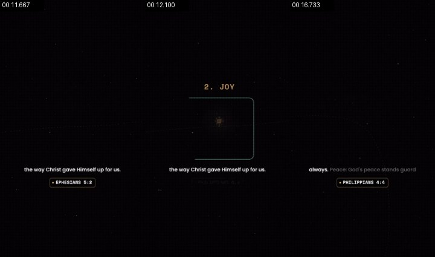

**Visible on screen** (check against the frames)
- Picture: Joy: sun on a nearly black textured canvas, mint outline card, gold mono heading, white subtitles and scripture badge.
- [AI assistant review] Stable card geometry and typography across frames.
- [AI assistant review] Illustrated icons undergo rigid transforms; no live camera footage visible.

**How it was made, as inferred by the tools** (inferred, not seen)
- Inference: code / template render 88%, 2D animation 5%, 3D render 2% (fused_agent)
- Material: rendered by the creator
- Basis (tool measurements, not necessarily visible to the eye):
  - 71% of adjacent frames are exact duplicates, only local elements move (typical of template / motion-graphics animation, or a hold with local motion)
  - On a dark ground the lit part is almost all fine dots / thin lines (with the smooth background taken out, only 6% of lit pixels shade gently, 19 bright peaks per 100 lit pixels): particle / point-cloud / wireframe graphics, not a shaded photo, 3D surface or AI picture
  - Rendered texture: 0% flat colour blocks, 95% of pixels use only 1 colours, 32% axis-aligned edges
  - 97% of background pixels never change frame to frame while local elements move: 2D compositing / code-driven motion graphics

- Remake: Code render: rebuild in an HTML video framework (such as HyperFrames or Remotion) from the rhythm, key frames and layout, 100% controllable, no generative model needed

#4 00:16.767–00:20.933 · code / template render

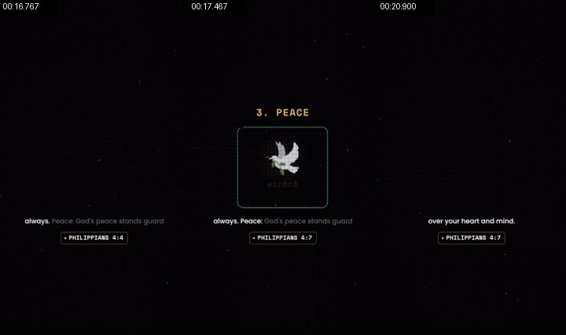

**Visible on screen** (check against the frames)
- Picture: Peace: dove on a nearly black textured canvas, mint outline card, gold mono heading, white subtitles and scripture badge.
- [AI assistant review] Stable card geometry and typography across frames.
- [AI assistant review] Illustrated icons undergo rigid transforms; no live camera footage visible.

**How it was made, as inferred by the tools** (inferred, not seen)
- Inference: code / template render 87%, 2D animation 5%, 3D render 2% (fused_agent)
- Material: rendered by the creator
- Basis (tool measurements, not necessarily visible to the eye):
  - On a dark ground the lit part is almost all fine dots / thin lines (with the smooth background taken out, only 6% of lit pixels shade gently, 19 bright peaks per 100 lit pixels): particle / point-cloud / wireframe graphics, not a shaded photo, 3D surface or AI picture
  - Rendered texture: 0% flat colour blocks, 95% of pixels use only 1 colours, 31% axis-aligned edges
  - 96% of background pixels never change frame to frame while local elements move: 2D compositing / code-driven motion graphics

- Remake: Code render: rebuild in an HTML video framework (such as HyperFrames or Remotion) from the rhythm, key frames and layout, 100% controllable, no generative model needed

#5 00:20.933–00:24.133 · code / template render

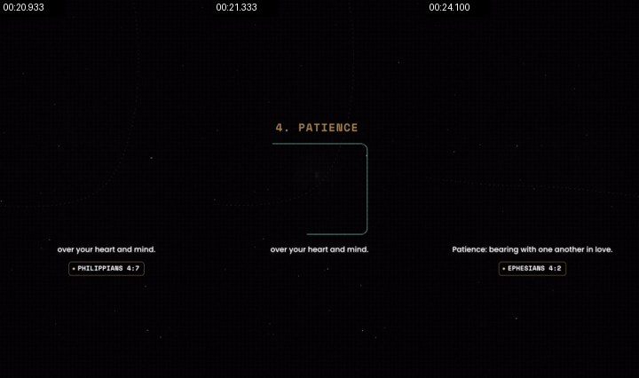

**Visible on screen** (check against the frames)
- Picture: Patience: rotating hourglass on a nearly black textured canvas, mint outline card, gold mono heading, white subtitles and scripture badge.
- [AI assistant review] Stable card geometry and typography across frames.
- [AI assistant review] Illustrated icons undergo rigid transforms; no live camera footage visible.

**How it was made, as inferred by the tools** (inferred, not seen)
- Inference: code / template render 87%, 2D animation 5%, 3D render 3% (fused_agent)
- Material: rendered by the creator
- Basis (tool measurements, not necessarily visible to the eye):
  - On a dark ground the lit part is almost all fine dots / thin lines (with the smooth background taken out, only 5% of lit pixels shade gently, 18 bright peaks per 100 lit pixels): particle / point-cloud / wireframe graphics, not a shaded photo, 3D surface or AI picture
  - Rendered texture: 0% flat colour blocks, 95% of pixels use only 1 colours, 31% axis-aligned edges

- Remake: Code render: rebuild in an HTML video framework (such as HyperFrames or Remotion) from the rhythm, key frames and layout, 100% controllable, no generative model needed

#6 00:24.133–00:29.133 · code / template render

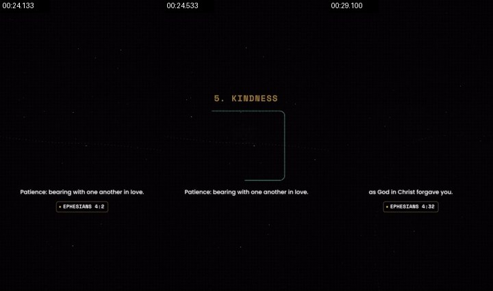

**Visible on screen** (check against the frames)
- Picture: Kindness: smiling face on a nearly black textured canvas, mint outline card, gold mono heading, white subtitles and scripture badge.
- [AI assistant review] Stable card geometry and typography across frames.
- [AI assistant review] Illustrated icons undergo rigid transforms; no live camera footage visible.

**How it was made, as inferred by the tools** (inferred, not seen)
- Inference: code / template render 87%, 2D animation 5%, 3D render 2% (fused_agent)
- Material: rendered by the creator
- Basis (tool measurements, not necessarily visible to the eye):
  - On a dark ground the lit part is almost all fine dots / thin lines (with the smooth background taken out, only 6% of lit pixels shade gently, 19 bright peaks per 100 lit pixels): particle / point-cloud / wireframe graphics, not a shaded photo, 3D surface or AI picture
  - Rendered texture: 0% flat colour blocks, 95% of pixels use only 1 colours, 28% axis-aligned edges
  - 96% of background pixels never change frame to frame while local elements move: 2D compositing / code-driven motion graphics

- Remake: Code render: rebuild in an HTML video framework (such as HyperFrames or Remotion) from the rhythm, key frames and layout, 100% controllable, no generative model needed

#7 00:29.133–00:33.167 · code / template render

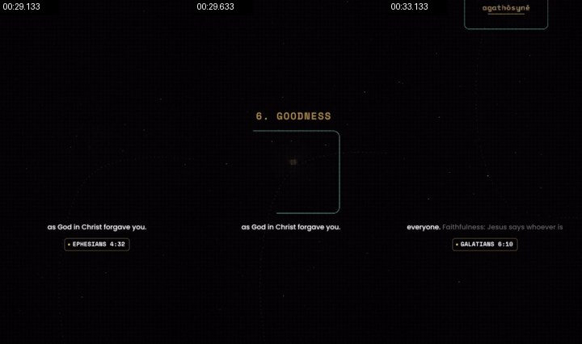

**Visible on screen** (check against the frames)
- Picture: Goodness: hands on a nearly black textured canvas, mint outline card, gold mono heading, white subtitles and scripture badge.
- [AI assistant review] Stable card geometry and typography across frames.
- [AI assistant review] Illustrated icons undergo rigid transforms; no live camera footage visible.

**How it was made, as inferred by the tools** (inferred, not seen)
- Inference: code / template render 87%, 2D animation 5%, 3D render 2% (fused_agent)
- Material: rendered by the creator
- Basis (tool measurements, not necessarily visible to the eye):
  - On a dark ground the lit part is almost all fine dots / thin lines (with the smooth background taken out, only 6% of lit pixels shade gently, 18 bright peaks per 100 lit pixels): particle / point-cloud / wireframe graphics, not a shaded photo, 3D surface or AI picture
  - Rendered texture: 0% flat colour blocks, 95% of pixels use only 1 colours, 30% axis-aligned edges
  - 96% of background pixels never change frame to frame while local elements move: 2D compositing / code-driven motion graphics

- Remake: Code render: rebuild in an HTML video framework (such as HyperFrames or Remotion) from the rhythm, key frames and layout, 100% controllable, no generative model needed

#8 00:33.167–00:33.600 · code / template render

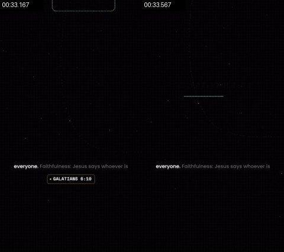

**Visible on screen** (check against the frames)
- Picture: Transition gap on a nearly black textured canvas, mint outline card, gold mono heading, white subtitles and scripture badge.
- [AI assistant review] Stable card geometry and typography across frames.
- [AI assistant review] Illustrated icons undergo rigid transforms; no live camera footage visible.

**How it was made, as inferred by the tools** (inferred, not seen)
- Inference: code / template render 97%, screen recording / screenshot 3%, 2D animation 0% (fused_agent)
- Material: rendered by the creator
- Basis (tool measurements, not necessarily visible to the eye):
  - Picture is almost entirely still: 88% of adjacent frames are pixel-identical, first-to-last frame difference 0.60
  - On a dark ground the lit part is almost all fine dots / thin lines (with the smooth background taken out, only 7% of lit pixels shade gently, 19 bright peaks per 100 lit pixels): particle / point-cloud / wireframe graphics, not a shaded photo, 3D surface or AI picture
  - Rendered texture: 0% flat colour blocks, 95% of pixels use only 1 colours, 32% axis-aligned edges

- Remake: Code render: rebuild in an HTML video framework (such as HyperFrames or Remotion) from the rhythm, key frames and layout, 100% controllable, no generative model needed

#9 00:33.600–00:39.167 · code / template render

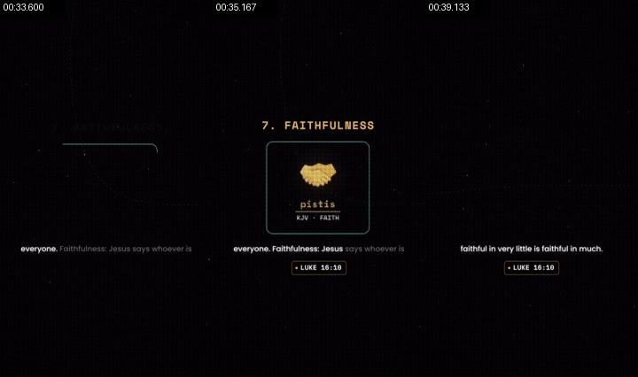

**Visible on screen** (check against the frames)
- Picture: Faithfulness: handshake on a nearly black textured canvas, mint outline card, gold mono heading, white subtitles and scripture badge.
- [AI assistant review] Stable card geometry and typography across frames.
- [AI assistant review] Illustrated icons undergo rigid transforms; no live camera footage visible.

**How it was made, as inferred by the tools** (inferred, not seen)
- Inference: code / template render 88%, 2D animation 5%, 3D render 2% (fused_agent)
- Material: rendered by the creator
- Basis (tool measurements, not necessarily visible to the eye):
  - 58% of adjacent frames are exact duplicates, only local elements move (typical of template / motion-graphics animation, or a hold with local motion)
  - On a dark ground the lit part is almost all fine dots / thin lines (with the smooth background taken out, only 6% of lit pixels shade gently, 18 bright peaks per 100 lit pixels): particle / point-cloud / wireframe graphics, not a shaded photo, 3D surface or AI picture
  - Rendered texture: 0% flat colour blocks, 95% of pixels use only 1 colours, 32% axis-aligned edges
  - 96% of background pixels never change frame to frame while local elements move: 2D compositing / code-driven motion graphics

- Remake: Code render: rebuild in an HTML video framework (such as HyperFrames or Remotion) from the rhythm, key frames and layout, 100% controllable, no generative model needed

#10 00:39.167–00:43.300 · code / template render

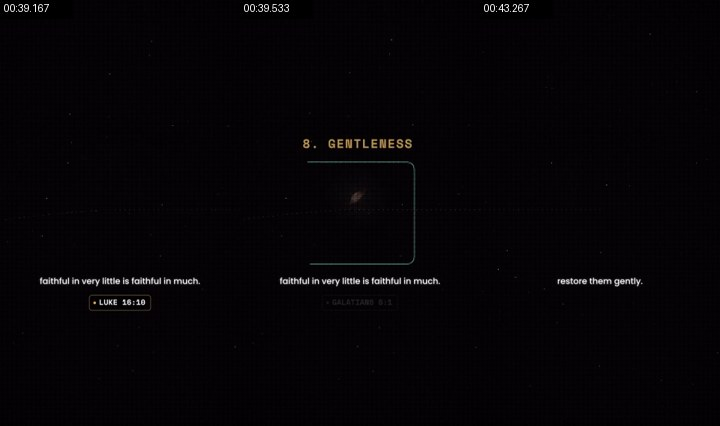

**Visible on screen** (check against the frames)
- Picture: Gentleness: feather on a nearly black textured canvas, mint outline card, gold mono heading, white subtitles and scripture badge.
- Motion beats within the shot: 43.27s
- [AI assistant review] Stable card geometry and typography across frames.
- [AI assistant review] Illustrated icons undergo rigid transforms; no live camera footage visible.

**How it was made, as inferred by the tools** (inferred, not seen)
- Inference: code / template render 87%, 2D animation 5%, 3D render 2% (fused_agent)
- Material: rendered by the creator
- Basis (tool measurements, not necessarily visible to the eye):
  - On a dark ground the lit part is almost all fine dots / thin lines (only 4% of lit pixels shade gently, 19 bright peaks per 100 lit pixels): particle / point-cloud / wireframe graphics, not a shaded photo, 3D surface or AI picture
  - Rendered texture: 0% flat colour blocks, 95% of pixels use only 1 colours, 33% axis-aligned edges
  - 96% of background pixels never change frame to frame while local elements move: 2D compositing / code-driven motion graphics

- Remake: Code render: rebuild in an HTML video framework (such as HyperFrames or Remotion) from the rhythm, key frames and layout, 100% controllable, no generative model needed

#11 00:43.300–00:48.967 · code / template render

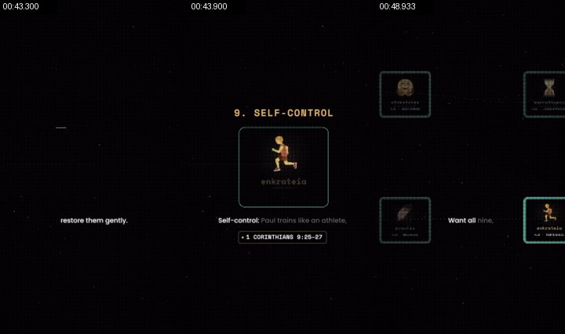

**Visible on screen** (check against the frames)
- Picture: Self-control: figure on a nearly black textured canvas, mint outline card, gold mono heading, white subtitles and scripture badge.
- [AI assistant review] Stable card geometry and typography across frames.
- [AI assistant review] Illustrated icons undergo rigid transforms; no live camera footage visible.

**How it was made, as inferred by the tools** (inferred, not seen)
- Inference: code / template render 88%, 2D animation 5%, 3D render 2% (fused_agent)
- Material: rendered by the creator
- Basis (tool measurements, not necessarily visible to the eye):
  - 57% of adjacent frames are exact duplicates, only local elements move (typical of template / motion-graphics animation, or a hold with local motion)
  - On a dark ground the lit part is almost all fine dots / thin lines (with the smooth background taken out, only 4% of lit pixels shade gently, 18 bright peaks per 100 lit pixels): particle / point-cloud / wireframe graphics, not a shaded photo, 3D surface or AI picture
  - Rendered texture: 0% flat colour blocks, 95% of pixels use only 1 colours, 35% axis-aligned edges
  - 97% of background pixels never change frame to frame while local elements move: 2D compositing / code-driven motion graphics

- Remake: Code render: rebuild in an HTML video framework (such as HyperFrames or Remotion) from the rhythm, key frames and layout, 100% controllable, no generative model needed

#12 00:48.967–00:51.267 · code / template render

**Visible on screen** (check against the frames)
- Picture: Connected grid pullback on a nearly black textured canvas, mint outline card, gold mono heading, white subtitles and scripture badge.
- [AI assistant review] Stable card geometry and typography across frames.
- [AI assistant review] Illustrated icons undergo rigid transforms; no live camera footage visible.

**How it was made, as inferred by the tools** (inferred, not seen)
- Inference: code / template render 85%, 2D animation 6%, 3D render 3% (fused_agent)
- Material: rendered by the creator
- Basis (tool measurements, not necessarily visible to the eye):
  - On a dark ground the lit part is almost all fine dots / thin lines (only 6% of lit pixels shade gently, 22 bright peaks per 100 lit pixels): particle / point-cloud / wireframe graphics, not a shaded photo, 3D surface or AI picture
  - Rendered texture: 0% flat colour blocks, 95% of pixels use only 10 colours, 21% axis-aligned edges

- Remake: Code render: rebuild in an HTML video framework (such as HyperFrames or Remotion) from the rhythm, key frames and layout, 100% controllable, no generative model needed

#13 00:51.267–00:56.800 · code / template render

**Visible on screen** (check against the frames)
- Picture: PDF download call to action on a nearly black textured canvas, mint outline card, gold mono heading, white subtitles and scripture badge.
- [AI assistant review] Stable card geometry and typography across frames.
- [AI assistant review] Illustrated icons undergo rigid transforms; no live camera footage visible.

**How it was made, as inferred by the tools** (inferred, not seen)
- Inference: code / template render 85%, 2D animation 6%, 3D render 3% (fused_agent)
- Material: rendered by the creator
- Basis (tool measurements, not necessarily visible to the eye):
  - 76% of adjacent frames are exact duplicates, only local elements move (typical of template / motion-graphics animation, or a hold with local motion)
  - Rendered texture: 57% flat colour blocks, 95% of pixels use only 5 colours, 40% axis-aligned edges
  - 99% of background pixels never change frame to frame while local elements move: 2D compositing / code-driven motion graphics

- Remake: Code render: rebuild in an HTML video framework (such as HyperFrames or Remotion) from the rhythm, key frames and layout, 100% controllable, no generative model needed

### Metadata clues

- Encoder: `AVC Coding`

### Notes

- Deterministic forensics is reliable on motion, whole-frame pan/zoom, rendered texture and 24→30 fps conversion; telling live action from AI from 3D needs image reading (a VLM or an AI assistant's review), and a look at the frames yourself.
- Platform transcoding usually strips metadata; missing metadata proves nothing.
- The full data is in `breakdown.json`; the package for models starts at `VIDEO.md`.

---

Made with [REA-VIDEO](https://github.com/JuneYaooo/rea-video) · https://github.com/JuneYaooo/rea-video
